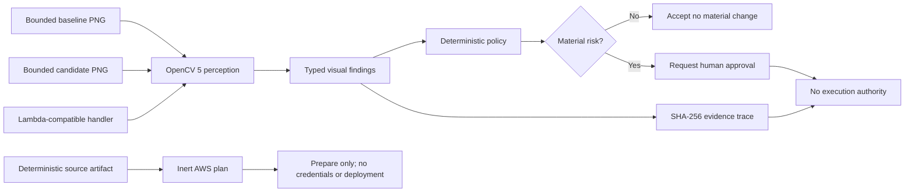

# Sightline Architecture — Draft, Not Submitted

A self-contained companion rendering is stored in `ARCHITECTURE.draft.svg`. It contains no external fonts, scripts, images, links, or network references.

## Trust Boundaries

- Image inputs are bounded and decoded locally.
- OpenCV findings are data, not execution authority.
- The decision engine has no mutation or deployment tool.
- The AWS plan is metadata only and cannot execute.
- Credential, deployment, and spend authority must remain false.
- Judge-facing materials exclude secrets, customer data, and private operational details.

## Demonstration extension

The proposed local journey uses a separate fixture controller. It is designed to request approval from OpenCV evidence, reject an unapproved action, and allow a scripted one-use, candidate-bound event to restore only the injected DOM visibility before remeasurement. The historical recording and its receipt were unavailable for this review. This does not add a production mutation tool to the planner. A real human approval was not observed. The revised delivery diagram shows this loop and places the unverified AWS runtime in a separately labeled boundary.
