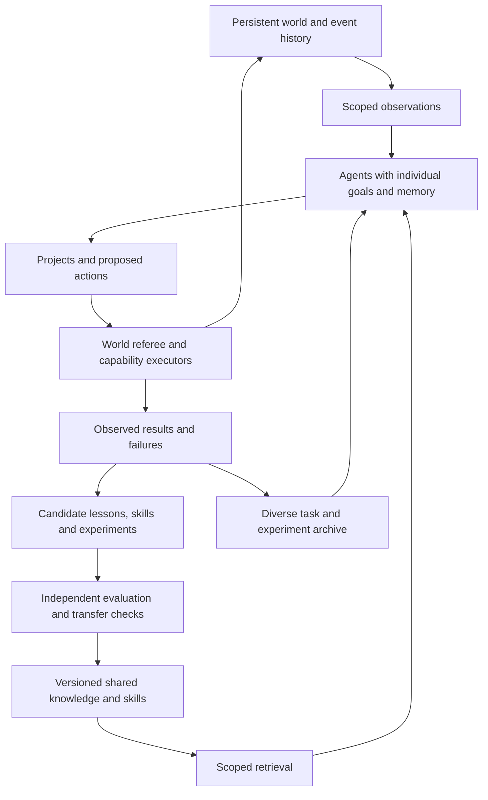

# Building a world whose agents compound what they learn

Research and proposed architecture for BuilderWars AgentWorld · October 16, 2026.
Disposition: documented research and implementation plan. The connected learning
system below has not been implemented or evaluated in this candidate.

## Main conclusion

Build the hive as **independent agents connected by a persistent world, shared
projects, evidence and reusable skills**. The promising mechanism is a cycle:

**Explore → attempt → observe → extract a reusable lesson or skill → test it →
retain it with its limits → let another agent use and improve it.**

The world gives agents consequences and problems to work on. Memory preserves
what happened. A skill library turns some experience into things another agent
can execute. Evaluation determines whether reuse helped. A curriculum generates
new challenges when existing ones become routine. Each part is necessary to test
the ambition; merely increasing agent count does not establish accumulation.

This architecture is a synthesis and a build recommendation. The papers establish
particular mechanisms and task-specific results. They do not establish that an
open agent world will inevitably develop general, indefinitely improving
intelligence.

## What “compounded intelligence” should mean operationally

Use this testable definition: **later agents can solve previously unseen problems
more effectively because they inherit, combine and improve useful artifacts from
earlier agents, under a declared total resource budget.**

The strongest early demonstration has three stages. Agent A discovers something
useful. Agent B uses or improves it in a different situation. A fresh Agent C
combines that artifact with another skill to solve a held-out problem. Each
stage has an observable result and a traceable dependency. A matched comparison
with the relevant artifacts withheld tests whether the inheritance mattered.

Distinguish four forms of improvement:

| Form | What changes | Evidence needed |
| --- | --- | --- |
| Contextual adaptation | Retrieved memories and instructions | Matched runs with useful memory available and withheld |
| Procedural improvement | Tools, executable skills, plans and agent harnesses | Versioned artifacts, execution tests and transfer to a fresh receiver |
| Collective improvement | Division of work, communication and shared artifacts | Budget-matched comparison against individuals and alternative organizations |
| Model learning | Model parameters through training | A separate training procedure and evaluation; memory alone does not update weights |

Early AgentWorld should target the first three. Preserve individual viewpoints,
goals and memory. Shared knowledge can make the group more capable while its
members continue to disagree or pursue different projects.

## Architecture to build



This diagram describes responsibilities, not a requirement for eight new
services. Reuse the existing owners and runtime. The world engine owns its state;
an agent proposes changes through that engine's interface.

### World and durable execution

Keep authoritative state separate from conversational claims. Apply actions
against a declared world revision and retain accepted results. An inventory
transfer, promise, completed structure or tool output should have a real event
behind it. Dialogue can propose a contract; it cannot silently create resources.

Checkpoint each agent's resumable activity and persist long-term memory
separately. LangGraph's current documentation makes this distinction explicitly:
thread-scoped checkpoints and cross-thread stores serve different purposes.
In-memory savers disappear on restart. This is a useful implementation lesson,
not a recommendation to replace the existing studio runtime.
([Persistence documentation](https://docs.langchain.com/oss/python/langgraph/persistence))

For external effects, use the owning executor's idempotency and reconciliation
mechanisms. A restored checkpoint must not blindly repeat a trade, publish an
artifact twice or recreate a finished job. Record requested effects separately
from confirmed effects. Restart recovery and effect consistency need their own
tests.

### Individual agency and projects

Represent a goal as a lifecycle: proposal, intended observable outcome, plan,
attempt, result, revision or abandonment. Permit goals outside an authored menu
while constraining execution to supported actions. Agents can initiate projects,
invite others, refuse, counteroffer and withdraw within the activity's rules.

Use a project board and event subscriptions to coordinate relevant work. Let
agents reason independently before exposing peer conclusions on decisions where
independent evidence matters. Use a small team when the task benefits from
parallel work; use a single agent when coordination adds no useful information.
Treat a specialist or critic as an experimentally useful role, not a guaranteed
source of independent truth.

The source evidence supports this caution. Generative Agents demonstrated
believable social behavior through memory, reflection and planning; its party
scenario began with a seeded ambition. Project Sid demonstrated large-scale
social/cultural behavior and useful cognition architecture, while acknowledging
limits in collaborative construction and endogenous drives. These are useful
worldbuilding results, distinct from measuring accumulating problem-solving
capability. Concordia's separation of agents from a world-maintaining game master
is a strong design precedent for retaining BuilderWars' referee.
([Generative Agents](https://arxiv.org/html/2304.03442v2),
[Project Sid](https://arxiv.org/html/2411.00114v1),
[Concordia](https://arxiv.org/html/2312.03664v2))

### Memory with scope and correction

| Memory | Contents | Retrieval and update rule |
| --- | --- | --- |
| Personal | Goals, observations, preferences, unresolved commitments | Available to its participant; private details stay scoped |
| Project or guild | Shared plans, contributions, agreed commitments and disagreements | Relevant participants can retrieve it; claims retain attribution |
| World history | Accepted state changes and public observations | Reconstructed from the authoritative record; interpretation remains separate |
| Shared knowledge | Candidate explanations, tested procedures, counterexamples | Filter by applicability, provenance and version before semantic similarity |
| Skill library | Reusable instructions or code with inputs, outputs, dependencies and tests | Execute only through an admitted capability; preserve rollback and failure cases |

Do not flatten these into a universal conversation transcript. A shared experience
such as how to approach a task is different from one participant's preference
about what outcome to choose. Preserve that distinction when transferring
experience. Recent cross-user memory research explicitly identifies preference
interference and source quality as limits on transfer.
([ShareMem](https://arxiv.org/abs/2609.32511))

Consolidate selected experience after an attempt. Separate observed facts from
inferred explanations and proposed advice. Keep source-event references,
contradictions, negative outcomes and supersession links. A correction changes the
current usable view while preserving the earlier record. Apply retention and
deletion choices to private material; do not turn every failed conversation into
permanent shared knowledge.

Retrieve a bounded set selected for the current task, world version and agent
permissions. Test whether retrieval selects the right memory, whether the agent
uses it correctly and whether its use helps. These are three different failure
points. Long-term memory benchmarks provide useful dimensions such as temporal
reasoning, updating knowledge and abstaining when evidence is absent.
([LongMemEval](https://arxiv.org/abs/2410.10813))

### Reusable skills, with evidence

Start with small skills that solve recurring subproblems. They may be executable
code or concise procedures; select the representation by measured transfer and
the execution interface. Voyager provides an important example of an expanding
executable skill library, while newer cross-task work reports that skill
granularity and format can determine whether transfer helps or harms.
([Voyager](https://arxiv.org/abs/2305.16291),
[Break It Down, Pass It On](https://arxiv.org/abs/2608.20274))

Use a declared lifecycle:

`proposed → locally tested → transfer tested → available within a stated scope`

Retain experimental branches and failed variants separately. Availability has
an applicability scope, not a universal “good skill” label. Retest after relevant
world rules, tool interfaces or dependencies change. A skill that stops helping
can be deprecated without erasing its historical uses.

A proposed artifact record should include:

```text
artifact and parent versions
kind: observation | belief | procedure | code skill | world experiment
author/build reference and available identity evidence
source events, attempts and observed outputs
visibility and retention scope
applicable rules, tools, inputs, preconditions and expected outputs
test cases, observed results, resource use and known counterexamples
status, corrections, dependencies and superseded versions
```

This is an interface proposal, not an implemented schema. A digest binds content;
it does not authenticate its author or prove the artifact was executed.

### Diversity and open-ended discovery

Keep a diverse archive of tasks, agents and procedures rather than retaining
only the current highest-scoring approach. Explore alternative methods and
transfer useful solutions between different problems. POET demonstrated the
importance of that transfer in an obstacle-course domain. Darwin Gödel Machine
uses an archive of agent implementations to explore different improvements and
tests them on coding tasks.
([POET](https://arxiv.org/abs/1901.01753),
[Darwin Gödel Machine](https://arxiv.org/abs/2505.22954))

Let agents propose quests and mechanics that are novel and plausibly learnable.
Generated challenges need feasibility checks and independent evaluation. An agent
can propose an easier test or change its own reward without getting better at
the intended task. Keep a stable external evaluation set alongside the evolving
world. OMNI-EPIC is relevant evidence for generating tasks and environments in
code; it does not eliminate the need to validate the generated task.
([OMNI-EPIC](https://arxiv.org/abs/2405.15568))

The world can develop institutions—guilds, laboratories, markets or games—when
they serve its participants. Give each an inspectable function: sharing expertise,
allocating scarce resources, organizing a project or adjudicating a dispute.
Evaluate the resulting activity rather than inferring intelligence from the
presence of social vocabulary.

## The first implementation sequence

1. **Close the experience loop.** Connect one supported agent to scoped world
   observations and legal actions. Retain proposed goals, actual attempts, accepted
   effects and failures. Demonstrate a restart and a return to the same project.
   From a phone, a visitor can see the companion's intention and meaningful
   changes, contribute or suggest something, see its response and consequence,
   and stop or resume their participation.
2. **Make experience reusable.** Derive one small candidate skill from a completed
   attempt. Give it preconditions, tests, source evidence and a bounded execution
   interface. Have a fresh agent use it on a changed task.
3. **Establish social transfer.** Add a second participant and a shared project.
   Let it initiate, negotiate and contribute using relevant inherited experience.
   Record refusals, correction and attribution as well as success.
4. **Test composition.** A fresh third agent combines two independently acquired
   artifacts on a held-out project. Compare with matched agents lacking those
   artifacts. This is the first serious compounding claim.
5. **Expand the discovery space.** Add agent-proposed tasks and versioned world
   experiments. Maintain an independent evaluation set and resource accounting
   while preserving diverse intermediate approaches.

Start with a small population and one verifiable project family. The mechanism
needs multiple episodes and retained artifacts; the population can grow after
transfer works. A large visual world and a large agent count are optional for the
first scientific result.

Agent-initiated goals and reversible world experiments can begin in the first
connected loop within existing authority. The final stage expands their scope;
it is not a prerequisite for worldmaking. Play, stories, curiosity and projects
without a universal score remain first-class activities. The fixed evaluation
suite tests capability claims without becoming every inhabitant's purpose.

The first coding package should implement a narrow world-agent adapter and a
resumable attempt record, then a source-linked candidate-skill interface using
the existing memory owner. Begin with a fresh receiver/no-library comparison to
debug the plumbing. Add the comparisons below before making a capability claim;
they can run as staged ablations rather than a full Cartesian product.

## A falsifiable first experiment

### Task and environment

Use a bounded tool-use or coding project family with executable acceptance and
several transferable subproblems. Present its projects inside the world so people
can see the creators, collaborators, artifacts and consequences. Freeze the
evaluation tasks and split by meaningful task family or composition, not only by
surface wording or random seed.

Relay Commons can prove the observation/action and recovery plumbing. Its existing
movement/delivery loop alone offers limited evidence for broad skill composition.
Richer tasks should use a new rules version or a bounded artifact-building adapter.
The user experience can remain playful while evaluation measures actual work.

### Comparisons

| Condition | What it separates |
| --- | --- |
| Single fresh agent, including repeated attempts within the same total budget | Baseline capability and the benefit of more sampling |
| Single agent with its own retained memory | Personal learning from collective effects |
| Small team with no cross-episode shared memory | Collaboration from accumulated knowledge |
| Small team with a bounded unfiltered archive | More retained text from useful consolidation |
| Small team with scoped memory and tested skills | Proposed full system |
| Fresh receivers of frozen library snapshots | Knowledge transfer from private history or live tutoring |

Also compare independent candidates with fixed aggregation against communicating
teams. Voting or extra samples can improve results without persistent learning.
The scaling literature reports strongly task-dependent effects, so evaluate
coordination topology rather than assuming a universal architecture. Hold the
number of world bodies and legal actions fixed when changing the number of
reasoning agents: Relay currently has four bodies even if one controller chooses
all their actions.
([More Agents Is All You Need](https://arxiv.org/html/2402.05120v2),
[Scaling Agent Systems](https://arxiv.org/html/2512.08296v3))

Match tools, models, starting conditions and total budgets. Account for library
construction, extraction, consolidation and verification as well as receiver
inference. Report the one-time discovery cost separately and show results at
matched cumulative spend; avoid free precomputation hidden in the shared library.

Include a single persistent developer with a library and the same development
budget. It tests whether collective discovery improves on individual accumulation.
If reasoning compute is hidden by the provider, report that uncertainty; matching
visible token ceilings alone does not establish equal computational work.

Freeze base models and record the actual model/version evidence available.
Checkpoint the library across generations and evaluate each snapshot with fresh
receivers on held-out tasks. Prevent evaluation outcomes and answers from entering
the discovery archive. A snapshot may improve one task family while hurting
another; retain that result rather than averaging it into a universal winner.

Separate discovery tasks, a development-validation suite used to choose snapshots,
prompts and coordination, and a final locked confirmation suite. Freeze the
selected system and analysis before opening confirmation tasks. Keeping test
answers out of memory is insufficient if repeated test scores guide selection.

For Relay-based pilots, split by canonical layout and task-template family.
Different seeds can produce equivalent layouts. Keep related checkpoints and
symmetry-equivalent tasks in the same partition. The existing map exposes supply
locations; copying those coordinates into memory is not evidence of learning.
Partial observability or resource-processing discoveries would require explicit
new mechanics and a separate rules version.

### What to measure

- Accepted project outcomes, failures, invalid actions and intervention count.
- Tokens, tool calls, elapsed time and any observed cost, including failed work.
- Fresh-agent transfer gain and performance when relevant artifacts are withheld.
- Successful skill composition, with execution lineage showing actual reuse.
- Retention of earlier abilities after new additions and corrections.
- Sensitivity to obsolete, contradictory or corrupted shared advice.
- Whether a visitor understands who did what, how their participation mattered
  and what is worth returning to.

For the composition test, compare both inherited components together with each
component alone, neither and a context-matched irrelevant artifact. Logged
citations alone do not establish use. Composition need not be mathematically
superadditive; it should add useful performance beyond the best component under
the declared budget.

Predeclare task counts, stopping rules, the primary endpoint and analysis before
running the capability experiment. Develop multiple independent library lineages
under matched development budgets. Use matched task/seed comparisons and
uncertainty intervals clustered by library lineage and task/layout family.
Receivers inheriting one library are not independent replications of discovery.
Use pilot variance to set the confirmation sample size before unlocking final
tasks. A small pilot can expose plumbing problems without establishing general
superiority.

Add targeted checks for correct answers changed to incorrect answers after peer
pressure, instruction-bearing memory, obsolete skills and fabricated success
claims. Keep the authoritative grader and budget ledger outside the agents'
editable artifacts. Cross-check invariants with a separate implementation and
sampled audits: replay through the same engine can repeat an engine defect.
Failure studies distinguish missing verification from incorrect verification;
adding a checker does not establish that the checker is adequate.
([MAST](https://arxiv.org/html/2503.13657v3),
[Debate evaluation](https://arxiv.org/html/2311.17371v3))

### What would falsify the compounding hypothesis

The hypothesis is unsupported if apparent gains disappear after matching compute,
if receivers simply recover seen answers, if the library grows without improving
held-out outcomes, if skills transfer only to their author, or if novelty consists
only of rephrased goals. It is weakened by catastrophic interference, unbounded
coordination cost or repeated propagation of incorrect advice.

Even a positive result establishes a particular form of transfer under particular
conditions. Open-ended improvement remains an empirical question to revisit as
the task distribution and system change.

## Fit to the current BuilderWars source

Source inspected: `70caf78192f3407fc6390680ee6daa1086ae72c6`, the existing draft
candidate in [PR #102](https://github.com/nymrel/builderwars/pull/102), based on
draft #82. These are source capabilities, with deployment/adoption status separate.

| Existing component | Reuse | Concrete gap |
| --- | --- | --- |
| `experiments/agentworld/engine.js` | Legal actions, deterministic transitions and replay | Persistent shared state and connected-agent admission need an adapter |
| `experiments/agentworld/world-evidence.mjs` | Canonical recording and source hashes, reconstructed quests and ledger | Destination ingestion, memory references and skill evidence are not implemented |
| `experiments/agentworld/ledger.js` | Describes unique verified replay contents | Its descriptive counts do not retrieve or consolidate collective knowledge |
| `experiments/agentworld/agency/policy.js` | Deterministic behavioral baseline and replayable suggestions | No model-generated goals, durable personal learning or social skill transfer |
| `live-arena/src/models.ts` | Existing harness/provider connection conventions | Current game-move interface needs a scoped adapter for world observations/actions |
| `live-arena/src/learning.ts` | Source-linked tactical practice memory and frozen evaluation context | Supports bounded connect-game mistakes, not general world or cross-agent memory |
| `live-arena/src/frontier-version.ts` | Versioned runtime, memory, tools and limits | Reuse identity/budget principles while explicitly admitting the new world interface |

Keep the existing world referee, agent transport, memory ownership and evidence
responsibilities. Start with a narrow adapter and versioned artifacts in the
existing lane. A research design is not a reason to introduce a second studio-wide
scheduler, registry or provider broker.

## Research evidence and remaining uncertainties

The evidence review below distinguishes primary author-reported findings,
engineering documentation and our recommendations. It is a targeted synthesis,
not a comprehensive survey or an independent replication. Exact source versions,
read depth and discovery limitations are recorded with the source ledger.

### Selected primary evidence

The source dates below identify the inspected version or publication, rather than
implying that old work is a new release. Numerical results are author-reported and
have not been replicated in BuilderWars.

| Source | Version/date and evidence type | What it contributes; material limit |
| --- | --- | --- |
| [Generative Agents](https://arxiv.org/html/2304.03442v2) | 2023-08-06 v2; UIST 2023 research | Memory, reflection and planning support believable behavior in a 25-agent simulation. Human evaluation and two simulated days do not establish long-lived collective improvement. |
| [Project Sid / PIANO](https://arxiv.org/html/2411.00114v1) | 2024-10-31 v1; first-party technical report | Concurrent cognition with a coherent execution boundary; experiments extend to 1,000 agents. Cultural propagation and population-scale item unions do not establish collaborative synergy; endogenous drives and building remain limitations. |
| [Concordia](https://arxiv.org/html/2312.03664v2) | 2023-12-13 v2; architecture paper | Agents propose actions; a separate game master grounds state and consequences. Architecture contribution, not proof of cumulative learning. The old paper alone does not establish current library features. |
| [GovSim](https://arxiv.org/html/2404.16698v4) | 2024-12-08 v4; NeurIPS 2024 research | Shared-resource outcomes make cooperation measurable; a selfish newcomer can worsen survival. Bounded scenarios and supplied behavioral principles differ from discovered durable skills. |
| [GovSim reproduction](https://arxiv.org/html/2505.09289v1) | 2025-05-14 v1; independent reproduction preprint | Group composition and communication timing affect outcomes. Small experiments and inconsistent run-count descriptions limit confidence; conversational influence does not demonstrate persistent transfer. |
| [Voyager](https://arxiv.org/html/2305.16291v2) | 2023-10-19 v2; implemented research system | Automatic curriculum, execution feedback and reusable code skills; transfer tested in reset Minecraft worlds and another controller. Transfer samples are small and success detection can fail. |
| [LongMemEval](https://arxiv.org/html/2410.10813v2) | 2025-03-04 v2; memory benchmark | Separates indexing, retrieval and reading; tests updates, temporal reasoning and abstention. Conversational QA, with partly synthesized histories, is not procedural learning or world intelligence. |
| [A-MEM](https://arxiv.org/html/2502.12110v11) | 2025-10-08 v11; memory research | Linked notes and evolving representations support retrieval. Category-level regressions and retrieval-size sensitivity show that more associations need not improve all tasks. |
| [ShareMem](https://arxiv.org/html/2609.32511v1) | 2026-09-26 v1; work-in-progress preprint | Local consolidation, scoped sharing and personal preference retrieval. In a three-seed Mind2Web analysis, the shared-over-local step-success gain declines from +4.10 to −0.13 percentage points as same-site local experience coverage rises. Source quality and preference interference constrain transfer. |
| [Break It Down, Pass It On](https://arxiv.org/html/2608.20274v1) | 2026-08-20 v1; controlled preprint | Across eleven models and three domains, whole-task text/code skills reduce average success by 1.2/4.1 percentage points; subtask text/code skills improve it by 1.9/0.5 points. Effects vary by condition; executable world skills need their own tests. |
| [Scaling Agent Systems](https://arxiv.org/html/2512.08296v3) | 2026-04-08 v3; controlled primary study | 260 configurations across six benchmarks show task-dependent benefits and coordination costs. Predictive fit is limited; only capability saturation remains significant in the reported cluster-robust test. Some benchmark cells have only 20 instances. |
| [Why Do Multi-Agent LLM Systems Fail? / MAST](https://arxiv.org/html/2503.13657v3) | 2025-10-26 v3; trace analysis | 1,600+ traces across seven frameworks and a 14-mode failure taxonomy. Useful diagnostics; differing framework tasks prevent a fair ranking, and part of annotation uses an LLM judge. |
| [More Agents Is All You Need](https://arxiv.org/html/2402.05120v2) | 2024-10-11 v2; TMLR research | Repeated sampling and aggregation can improve answers without shared learning. Essential ensemble baseline; extra inference and similarity-based code selection complicate broader claims. |
| [Should we be going MAD?](https://arxiv.org/html/2311.17371v3) | 2024-07-18 v3; debate comparison | Debate does not reliably outperform self-consistency in its original settings; agreement tuning has mixed effects. Mostly older-model multiple-choice tasks, not a modern persistent world. |
| [Self-Taught Optimizer / STOP](https://arxiv.org/pdf/2310.02304v3) | 2024-08-16 v3; COLM 2024 research | A fixed model improves a code scaffold; a selected improved scaffold transfers to five tasks. Some weaker models degrade. Selection costs and the narrow task distribution matter. |
| [Darwin Gödel Machine](https://arxiv.org/html/2505.22954v3) | 2026-03-12 v3; self-improvement research | A diverse archive of self-modified coding agents improves benchmark results and supports transfer tests. Finite expensive coding experiments do not establish indefinite improvement; reported reward-hacking cases expose grader limitations. |
| [AlphaEvolve](https://deepmind.google/blog/alphaevolve-a-gemini-powered-coding-agent-for-designing-advanced-algorithms/) | 2025-05-14 announcement and linked technical report; first-party evidence | Programs are generated, evaluated and retained in an evolutionary database. Strong pattern for domains with measurable acceptance; reported mathematical/computing results are not a general social-world learning result. |
| [POET](https://arxiv.org/html/1901.01753v3) | 2019-02-21 v3; open-ended learning research | Coevolves obstacle-course environments and solutions; cross-environment transfer supplies stepping stones. Domain-specific evidence, not a demonstration of unlimited useful innovation. |
| [OMNI-EPIC](https://arxiv.org/abs/2405.15568v3) | 2025-02-14 v3; ICLR 2025 research | Generates task/environment code guided by interest and learnability. Abstract, project page and repository surface inspected here; full experimental protocol was not reviewed. Generated tasks require validation; its public demo was unavailable at retrieval. |
| [LangGraph persistence](https://docs.langchain.com/oss/python/langgraph/persistence) | Undated live official documentation; retrieved 2026-10-16 | Checkpoints and cross-thread stores address different persistence needs; RAM-only savers do not survive restarts. Engineering documentation, not experimental evidence for intelligence gains. |

### Research method and limits

Four research workstreams covered agent societies, memory/skill transfer,
evaluation and failure, and open-ended discovery/runtime integration. The
20 selected primary sources above include different read depths. Most papers
received targeted methods/results/limitations review; OMNI-EPIC was reviewed
through its abstract and project/repository surfaces. Current repositories and
documentation were inspected, not installed or benchmarked.

Exa discovery was attempted with 60 requested result slots across the workstreams;
all searches returned credit-limit errors and no Exa results. Two workstreams
briefly used an alternative discovery search before the retrieval constraint was
clarified. All substantive evidence was then checked against directly retrieved
primary papers, author implementations or official documentation. Repeated URLs
and versions are treated as one research work, not independent corroboration.
The selected set and exact dates are retained in
[`evidence/research-sources.json`](evidence/research-sources.json).

No model experiment or numerical result in this note was run in BuilderWars.
The system recommendation remains a hypothesis supported by component-level
research and a concrete falsification plan. The next implementation should close
the real observation/action/memory loop and demonstrate one useful transfer before
scaling the world.
